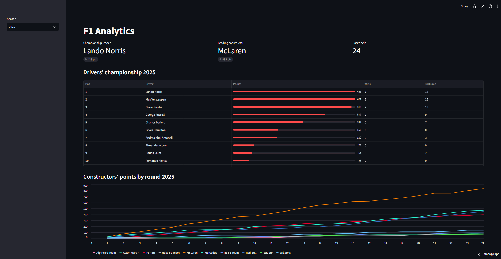
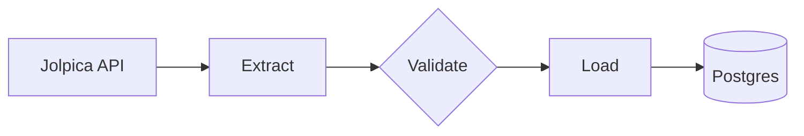
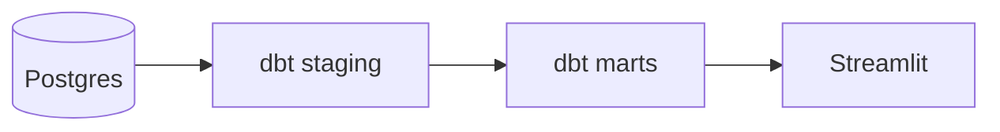

# F1 ETL Pipeline

[Tests](https://github.com/ssilvestre95/f1-etl/actions/workflows/tests.yml/badge.svg)

A small ETL pipeline that extracts Formula 1 race and sprint results from the
[Jolpica F1 API](https://api.jolpi.ca/ergast/f1/), transforms them into a
dimensional model with `pandas`, and loads them into PostgreSQL.

**Live dashboard:** [f1-etl-analytics.streamlit.app](https://f1-etl-analytics.streamlit.app)




## Pipeline

**Ingestion** (runs weekly via GitHub Actions)



**Analytics**



## Features

- **Incremental loads:** only rounds missing from the database are requested.
- **Idempotent:** loads use upserts, so re-running never duplicates data.
- **Resilient extraction:** pagination, timeouts, and retries with backoff on
  temporary errors (`429`, `5xx`, network failures).
- **Raw layer:** each race is saved as JSON in `data/raw/` before transforming.
- **Tested:** pytest suite for the transform and load logic, run in CI against a dedicated Postgres branch.
- **Scheduled:** a GitHub Actions workflow runs the pipeline every Monday and
  can also be triggered manually.
- **Atomic runs:** each run is a single transaction, so a failure never leaves
  a season half-loaded.
- **Analytics layer:** dbt models (staging views and mart tables) with 29 data
  tests, rebuilt after every scheduled load.
- **Dashboard:** a Streamlit app that reads the marts through a read-only
  database role.

## Data model

| Table | Grain |
|---|---|
| `fact_results` | one row per driver per race |
| `fact_sprint_results` | one row per driver per sprint |
| `dim_driver` | one row per driver |
| `dim_constructor` | one row per team |
| `dim_race` | one row per race (`season`, `round`) |

`is_classified` is derived from the API's `positionText` (numeric means
classified; `R`, `D` and `W` mean retired, disqualified and withdrawn).

## Analytics layer (dbt)

Models live in `dbt_f1/` and build into the `analytics` schema, separate from
the raw `public` tables.

| Layer | Models |
|---|---|
| `staging` (views) | `stg_race_results`, `stg_sprint_results`, `stg_drivers`, `stg_constructors`, `stg_races` |
| `marts` (tables) | `fct_session_results`, `driver_standings`, `constructor_points_by_race` |

Tests include unique keys, foreign-key relationships, accepted values, one
winner per session, and a reconciliation check: driver points and constructor
points must add up to the same total per season.

```bash
pip install -r requirements-dbt.txt
cd dbt_f1
dbt build --profiles-dir .
```

`profiles.yml` reads `DBT_HOST`, `DBT_USER`, `DBT_PASSWORD` and `DBT_DBNAME`
from the environment.

## Dashboard

`dashboard/app.py` shows the drivers' championship and the constructors'
points by round for any loaded season. It connects with a role that can only
read the `analytics` schema:

```sql
CREATE ROLE dashboard_reader WITH LOGIN PASSWORD '...';
GRANT USAGE ON SCHEMA analytics TO dashboard_reader;
GRANT SELECT ON ALL TABLES IN SCHEMA analytics TO dashboard_reader;
ALTER DEFAULT PRIVILEGES IN SCHEMA analytics GRANT SELECT ON TABLES TO dashboard_reader;
```

```bash
pip install -r dashboard/requirements.txt
echo "DASHBOARD_DATABASE_URL=postgresql://dashboard_reader:..." >> .env
streamlit run dashboard/app.py
```

## Design decisions

- **Classification flag:** `is_classified` comes from the API's `positionText`,
  not from `status` or lap count. Retired drivers who complete 90% of the race
  are still classified, and one disqualified driver kept a numeric position.
- **Separate sprint fact table:** sprints are a different event with their own
  points, so they live in `fact_sprint_results`. The `results` endpoint alone
  understates championship totals.
- **Incremental by round:** the pipeline compares the season calendar with the
  rounds already loaded and only requests the missing ones.
- **Validate before load:** raw data is saved first, then checked (one winner,
  no duplicate drivers, plausible grid size). A failed check aborts the run
  before anything is written, and the workflow turns red.
- **Retry only transient errors:** `429`, `5xx` and network failures are
  retried with backoff; other `4xx` errors fail immediately.

## Usage

You need a PostgreSQL database (a free [Neon](https://neon.com) project works).

```bash
python3 -m venv .venv
source .venv/bin/activate
pip install -r requirements.txt

echo "DATABASE_URL=postgresql://..." > .env   # your connection string

python main.py 2024          # one season
python main.py 2023 2024     # several seasons
```

### Tests

Tests need a separate database, so they never touch real data. Add a second
connection string to `.env` (for example, a Neon branch called `test`):

```bash
TEST_DATABASE_URL=postgresql://...
python -m pytest -v
```

### Scheduling

`.github/workflows/etl.yml` runs every Monday: the pipeline first, then
`dbt build`. If validation or any dbt test fails, the workflow turns red. It
expects a `DATABASE_URL` repository secret.

## Project structure

etl/
├── extract.py     # API calls, pagination, retries, raw JSON
├── validate.py    # checks on raw data before loading
├── transform.py   # flatten, type, and model the data
└── load.py        # Postgres schema and upserts
dbt_f1/            # dbt project: staging views, marts, data tests
dashboard/         # Streamlit app
tests/             # pytest suites
main.py            # orchestrates the pipeline

## Example query

## Example query

```sql
SELECT championship_position, driver_name, points, wins
FROM analytics.driver_standings
WHERE season = 2024
ORDER BY championship_position
LIMIT 5;
```

Sprint points live in `fact_sprint_results` and must be added to match the official championship totals.